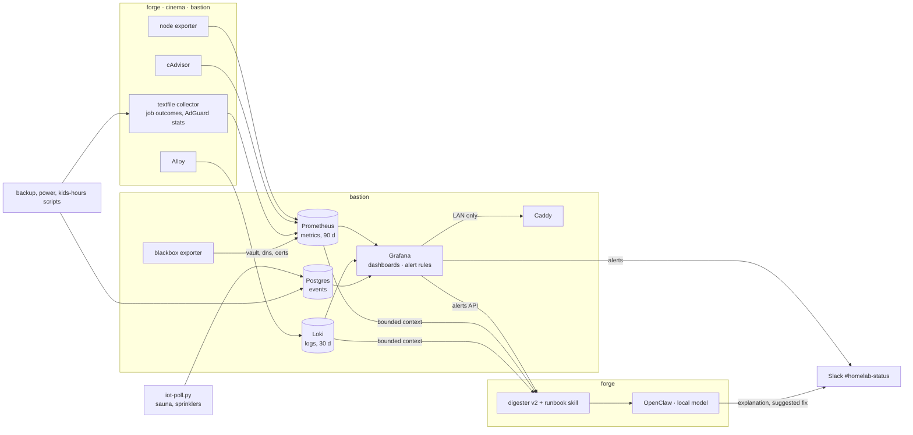

# Plan: observability — a store, dashboards, alerts, and where the model fits

Written 2026-09-27, after the question "is logging to Slack and letting OpenClaw read it the
best we can do?" The answer was no, and this is the replacement: **self-hosted end to end**,
rules decide severity, Slack becomes a notification channel instead of a database, and the
model is asked the questions a rule cannot answer.

It builds on the state in [plan-2026-09-27.md](plan-2026-09-27.md) (patched hosts, AdGuard as
DHCP and DNS, hardened agent) and absorbs Part 2 of
[plan-kids-hours-and-iot.md](plan-kids-hours-and-iot.md): the sauna and sprinkler pollers write
to the events table described here rather than to JSON files, and the kids' off-hours blocks
become a panel rather than a report.

## Principles, stated once

1. **Self-hosted.** Every component below runs on bastion or as an exporter on a host, is open
   source, and needs no account or cloud to function. The only external things are Slack, for
   the alert that has to reach a phone when bastion itself is down, and the device vendors'
   clouds, which are the only way to read the sauna and the sprinklers.
2. **Rules decide, the model explains.** Unchanged from `health-digest.py`. No alert is raised
   or suppressed by a model.
3. **LAN-only, behind the same guards as everything else.** Grafana gets a Caddy vhost with the
   `remote_ip` allow-list and `tls internal`, exactly like the AdGuard admin page. Prometheus,
   Loki and Postgres never bind to the LAN.
4. **Pinned, deployed, validated.** New compose files and configs live in the repo, are pushed
   by `deploy.sh`, validated by `apply.sh --validate`, and every image tag is pinned. Dashboards
   and alert rules are provisioned from files in git, not clicked together in the UI.
5. **bastion hosts it.** It is the only always-on machine; a dashboard on forge would be dark
   from 23:00 to 05:00. That means the vault host grows four services, which principle 3 is the
   answer to. Measured 2026-09-27 after its reboot: 1.1 GB used of 15.9, 88 GB disk free, four
   cores. The stack below needs about 1 GB and a few GB a year.

## Architecture



## Components and placement

Versions are what upstream published on 2026-09-27; the compose files pin them and the
upgrades skill gains a package file for each Watch-tier one.

| Component | Runs on | Purpose | Tier |
|---|---|---|---|
| Prometheus | bastion | metrics store, 90-day retention | Watch (holds nothing secret, but LAN-reachable via Caddy) |
| node exporter | bastion, forge, cinema | CPU, memory, disk, network, systemd units, plus the **textfile collector** | Drift |
| cAdvisor | bastion, forge, cinema | per-container CPU, memory, restarts | Drift |
| blackbox exporter | bastion | HTTPS probes of `vault.robbywhite.net` (status, certificate days), DNS probes of AdGuard, ICMP to every host and to vault's schedule | Drift |
| Alloy | bastion, forge, cinema | ships journald and Docker logs to Loki; replaces Promtail, which is end-of-life | Drift |
| Loki | bastion | log store, 30-day retention | Drift |
| Postgres | bastion | one `events` table for things with a start, an end and a result | Watch (the sauna and sprinkler credentials are not in it, but it is a database on the vault host) |
| Grafana | bastion | dashboards, alert rules, Slack contact point | Watch (a login on the vault host, LAN-only) |
| Caddy | bastion, exists | `grafana.robbywhite.net` LAN-only; `metrics.robbywhite.net` with basic auth for forge's digester | already Watch |

**Not used, deliberately:** a third-party AdGuard exporter. The two well-known ones are
archived and the most active survivor is small; any of them would hold the AdGuard admin
password. A forty-line script of our own reads `/control/stats` and `/control/clients` and
writes a `.prom` file for the textfile collector, which keeps the credential in bastion's
`.env` where the others are.

## The three data shapes

**Metrics** (Prometheus). Everything that is a number over time. Node and container metrics
come from the exporters. Everything the homelab's own scripts know goes through the textfile
collector — one line per fact, written atomically, overwritten each run:

```
homelab_job_last_success_timestamp{job="backup-to-tower"} 1790496607
homelab_job_last_exit{job="sync-forge"} 0
homelab_host_expected_up{host="forge"} 1
homelab_kids_window_open 0
adguard_queries_total 512345
adguard_blocked_total 41234
adguard_client_blocked_total{client="kid-pc"} 212
```

`homelab_host_expected_up` is the key to alerting on hosts that sleep by design: bastion's
`wake-forge.sh`, `sleep-forge.sh`, `wake-vault.sh` and `sleep-vault.sh` set it when they act,
so "forge is down" is only an alert when bastion asked it to be up. That is DST-proof and
reflects intent rather than a clock; a rule with `hour()` in UTC would be wrong twice a year.

**Logs** (Loki). journald from every host and stdout of every container, labelled by host,
unit and container. This replaces the `journalctl -p err` grep in the health verb with something
searchable, and it is what the digester's "last fifty matching lines" come from.

**Events** (Postgres). A row when something with a beginning and an end happens: a backup run,
a power job, a sauna session, a sprinkler run, a kids' window closing, a deploy. One table:

```sql
create table events (
  id         bigserial primary key,
  ts         timestamptz not null,       -- when it ended (or happened)
  started_at timestamptz,
  host       text not null,
  kind       text not null,              -- backup | power | sauna | sprinkler | kids | deploy
  name       text not null,              -- backup-to-tower, wake-vault, zone 3, …
  status     text not null,              -- ok | error | skipped
  detail     jsonb                       -- the script's own facts: minutes, peak_c, exit code
);
```

Grafana reads it directly, so "every sauna session this year" and "backup outcomes by week"
are queries, not scraping. Written by a tiny `bastion/scripts/event.py` helper the existing
scripts call at the point where they already write their log line.

This is where the Postgres-and-React idea landed: Postgres, yes, for events; Grafana instead of
React, because the frontend is the expensive part and Grafana already is one. If a custom page
is ever wanted, it queries the same tables.

## Security and exposure

- Prometheus (`:9090`), Loki (`:3100`) and Postgres (`:5432`) bind to `127.0.0.1` and the
  compose network only. Grafana reaches them by service name.
- Grafana is reachable only as `grafana.robbywhite.net` through Caddy, with the same
  `remote_ip 192.168.0.0/24` handle and `abort` as the AdGuard vhost, `tls internal`, and an
  AdGuard rewrite to `192.168.0.10`. Its admin password lives in bastion's `.env`; anonymous
  access off; sign-up off.
- forge's digester needs Prometheus and Loki. It gets `metrics.robbywhite.net` on Caddy, LAN-only
  plus `basic_auth`, with the credential in forge's `.env`. Nothing else on the LAN can query
  the stores.
- node exporter and cAdvisor on forge and cinema listen on the LAN (`:9100`, `:8080`) because
  Prometheus on bastion must reach them. They expose no secrets; `ufw` on each host limits them
  to bastion's address. **[you]** for the `ufw` rules, once per host.
- Alloy on forge and cinema pushes to Loki, so Loki needs one LAN-reachable ingest path: Caddy
  again, `loki.robbywhite.net` with basic auth, credential per host in its `.env`.
- Nothing here touches the internet-facing vault vhost.

## Backups

- **Grafana:** dashboards, data sources and alert rules are provisioned from the repo, so the
  running instance is reproducible from git. Its SQLite holds only users and preferences; it is
  copied into `backup-to-tower.sh`'s staging like `vw-data`.
- **Postgres:** `pg_dump` nightly to `~/backups/events-YYYY-MM-DD.sql.gz`, kept 14 days
  locally, mirrored to vault on Sunday with the rest.
- **Prometheus and Loki data:** not backed up. Ninety days of metrics and thirty of logs are
  regenerable in the sense that losing them costs history, not correctness, and they are the
  bulk of the disk.

## Phases

### Phase 0 — prerequisites [you + agent], an hour

- AdGuard rewrites for `grafana`, `metrics` and `loki` `.robbywhite.net` → `192.168.0.10` (agent,
  through the API once the AdGuard credential is in bastion's `.env` — the same prerequisite as
  the kids plan).
- `ufw` on forge and cinema: allow `9100/tcp` and `8080/tcp` from `192.168.0.10` only (you).
- `bastion/observability/` in the repo: compose file, Prometheus config, blackbox modules,
  Grafana provisioning tree, Postgres init SQL. `bastion/apply.sh` learns to validate and `up`
  a second compose project.

### Phase 1 — metrics and dashboards [agent], an afternoon

Prometheus, blackbox, Grafana on bastion; node exporter and cAdvisor on all three hosts;
the textfile collector fed by the backup, power and `os-update` scripts; the AdGuard stats
script. Provisioned dashboards: *Hosts* (the node exporter full dashboard, one row per host),
*Containers*, *Edge* (vault status, certificate days, DNS latency, ICMP to each host),
*Jobs* (last success and age for every scheduled job, coloured by `homelab_host_expected_up`).

**Done when:** all three hosts show in *Hosts* with cinema and forge greyed while asleep and not
red; *Edge* shows the certificate expiring 2026-12-21; *Jobs* shows Sunday's backup window
end to end. Nothing in the existing Slack pipeline has changed.

### Phase 2 — logs, events, the network map [agent], two evenings

Loki and Alloy; Postgres and `event.py`; the sauna and sprinkler pollers from the IoT plan
writing events; the kids' window and per-client blocks as metrics; a *Network* dashboard built
from AdGuard's lease and client tables (every device by name, IP, MAC vendor, last seen,
queries and blocks, with the children's devices tagged) and a *Logs* dashboard.

**Done when:** a sauna session shows up as a row with minutes and peak temperature; `journalctl`
on any host is answered by a Loki query; the *Network* dashboard lists every lease AdGuard holds.

### Phase 3 — alerting, and Slack stops being the database [agent], one evening

Grafana alert rules, provisioned from git, one per rule that lives in `health-digest.py` and
`health-report.py` today: filesystem over the threshold, a job's last success older than its
schedule allows, a job's last exit non-zero, a host down while expected up, the vault probe
failing, certificate under 21 days, Vaultwarden behind upstream (from the version-check
script's textfile line). Contact point: the `#homelab-status` webhook. Rules for sleeping hosts
use `homelab_host_expected_up`. The two catastrophe bypasses in `health-report.py` become
ordinary rules with the same wording.

Then, and only then: `health-report.py` stops posting to `#homelab-logs`, the health verb in
`openclaw-cmd` stays (the agent still needs an on-demand read), and `digest-watchdog.py` is
repointed from "was there a digest" to "is Grafana's own heartbeat rule firing to Slack",
which it does by watching for the daily digest the next phase still posts.

**Done when:** a forced failure (rename the backup log for a day) reaches Slack from Grafana,
and the same day's `#homelab-logs` is empty.

### Phase 4 — the model, asked the right questions [agent], one evening plus a skill

`health-digest.py` becomes the digester it was meant to be:

- **Daily narrative at 07:30**, from seven days of Prometheus and events rather than half an
  hour of Slack: what changed, what recurred, what is trending. Still posts every day, so
  silence still means something.
- **On an alert**, triggered by polling Grafana's alerts API every ten minutes as the triage
  run does now: retrieve deterministically — the alert, the last seven days of the metric it is
  about, the last fifty Loki lines matching its host and unit, the previous occurrence of the
  same rule from the events table — and ask the model two things: what is going on, and which
  runbook applies. Post the answer as a thread reply under the alert in Slack, escaped exactly
  as the summary is today. The model never changes the alert's severity.
- **A `homelab-runbooks` skill** in `.claude/skills/`, deployed to forge like the upgrades
  skill, one section per known failure with its fix: vault's array not started, forge not
  answering Wake-on-LAN, GDM unloading the GPU, rsync exit 23 to vault, Caddy's SNI alert,
  AdGuard's DHCPv6 coming back, a Slack socket that will not reconnect. Every one of these is
  already written down in a comment somewhere in this repo; the skill is where the model can
  find them. Matching an alert to a runbook is the task a small local model does well.

**Done when:** the next real alert arrives with a threaded explanation that names the right
runbook, and the morning narrative mentions something that only seven days of data could show.

**Deferred, as a gate rather than a phase:** letting the agent run the read-only health verbs
itself when an alert fires and *propose* a fix. The forced-command verbs make it safe to try;
whether it is worth having is a decision for after phase 4 has run for a month.

## Sizing

| | Memory | Disk | Notes |
|---|---|---|---|
| Prometheus | ~300 MB | ~2 GB / 90 d at this scrape volume | 15 s scrape on three hosts |
| Loki | ~250 MB | ~1 GB / 30 d | journald and containers only, no application chatter |
| Grafana | ~150 MB | ~50 MB | |
| Postgres | ~50 MB idle | negligible | a few thousand rows a year |
| Alloy, exporters | ~100 MB per host | — | |
| **bastion total** | **~1 GB** | **~4 GB** | of 14.7 GB and 88 GB free |

## Risks, named

- **bastion's blast radius grows.** Four more services on the host that runs DNS, DHCP and the
  vault. Mitigated by principle 3; accepted because the alternative is a fourth always-on
  machine.
- **Loki volume surprises.** A chatty container can fill it. Retention is enforced by size as
  well as age, and the *Logs* dashboard shows ingest rate per source from day one.
- **Alert fatigue from sleeping hosts.** The whole point of `homelab_host_expected_up`; the
  first week of phase 3 is spent watching for false alerts before `health-report.py` is retired.
- **Two alerting paths during phases 3–4.** Grafana and the old digester both post until the
  cut-over. Bounded to that week and visible, which is preferable to a flag day.
- **The model's context.** Sixteen thousand tokens on forge. Retrieval is deterministic and
  bounded precisely so the model is never handed a log file.

## Not doing

- A React frontend. Grafana is the frontend; the data is the durable part.
- Grafana Cloud, hosted Prometheus, or any SaaS in the path.
- Prometheus on forge, or anything stateful on a host that sleeps.
- Replacing Slack as the notification channel. An alert that only exists inside the LAN cannot
  reach a phone when bastion is the host that failed.

## Order of play

1. Phase 0 and 1 this week. Nothing changes for the current pipeline; you get dashboards.
2. Phase 2 the week after, together with the sauna and sprinkler pollers, which then have a
   place to write.
3. Phase 3 after a week of clean dashboards, with the old and new alerting overlapping for
   seven days before the old one is retired.
4. Phase 4 last, once there is a month of history for the narrative to read.
